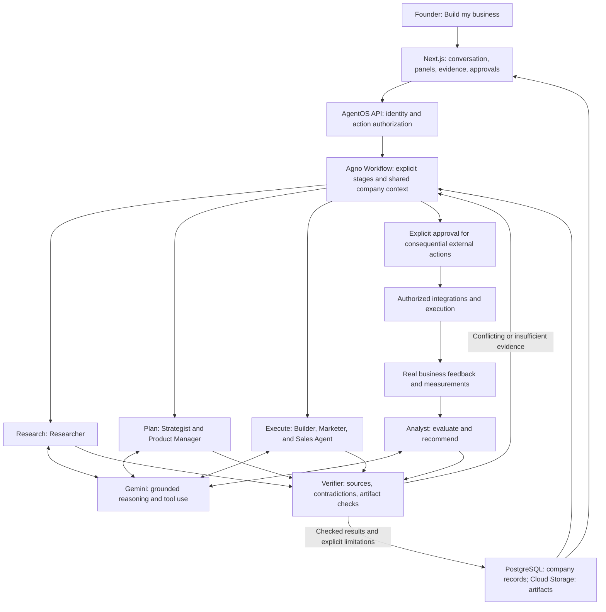

# Team Samurai — AI Idea → Company

An AI company-building workspace, developed as a general-purpose product and for Google AI Builder Cup 2026. Founders describe a business idea and work with one connected system to validate demand, shape an offer, find customers, coordinate delivery, and improve through business feedback.

Software generation is a supporting capability when the company needs it. The product's goal is business progress, not simply generating an app.

## Current status

Product direction, UI principles, and competition requirements are documented in [AGENTS.md](AGENTS.md). Samurai brand assets are available in [assets/samurai-logo](assets/samurai-logo).

The repository has a Next.js application with a health endpoint, local PostgreSQL in Podman, environment templates, and locked dependencies. When a Gemini model is configured, the current parent-agent source registers one ordinary AgentOS agent, **Samurai**, as the conversational entry point. It has four bounded tools: run or continue the company journey, create launch drafts, analyze provenance-labelled metrics, and read current company state. The nine specialist roles remain internal workflow executors.

The source defines the core journey as intake → brief check → grounded research → evidence check → strategy → product plan → verification. It retains typed, revisioned artifacts with founder statements, assumptions, source references, claims, and verification findings. Builder, Marketer, and Sales produce reviewable drafts only; Analyst requires eligible metrics and labels founder-supplied metrics as conditional. No current tool can publish, send, spend, contact prospects, run ads, or deploy.

Intake, Strategist, Product Manager, and Verifier preload the validated local skill text and expose no runtime function tools. Researcher has native Gemini Search only. Builder, Marketer, Sales, and Analyst use only local read-only skill functions; the parent exposes only bounded local skill inspection alongside its four business tools. Child workflows have a seven-model-timeout deadline (420 seconds with the default 60-second timeout), cancellation drains child runs, model requests are capped at the configured tool-call budget plus one, and child failures become sanitized typed errors.

At local final HEAD `9002382`, the integrated backend suite has 131 passing tests and Ruff and basedpyright are clean. A real JWT server probe on port 8000 verified unauthenticated 401, root 404, authorized configuration 200, owner-only run reads, and sanitized terminal errors. The authenticated API primary completed the five-artifact core journey to revision 5 with three unique grounded sources and nine propagated references; source-backed claims remain unverified and verification honestly returns `needs_rework`. The founder-supplied metrics path then completed at revision 6 with all seven required fields and a conditional `based_on_founder_supplied_metrics` result.

Local Chrome acceptance independently completed the approved fictional dental brief in 16 seconds, retained five unique sources, recalled the customer, budget, skills, conflicts, and next decision through `read_company_state`, and survived a reload without rerunning the child journey. A real TCP cancellation regression observed child progress, then `RunCancelled` about 20 ms after cancellation, persisted parent and child as `CANCELLED`, emptied the active registry, and retained no late artifact. These are local API, persistence, cancellation, and UI results; no live launch-draft generation, push, deployment, or external action is claimed.

The selected stack and phased implementation boundary are in [docs/architecture.md](docs/architecture.md). The active parent-agent acceptance work is in [the parent-agent plan](.omo/plans/samurai-parent-agents.md); the [AgentOS foundation plan](docs/agentos-foundation-plan.md) remains a historical record. This is not yet the complete company-building product.

## The idea: “Build my business.”

The founder starts with one question:

> **What do you want to build?**
>
> “An AI receptionist for Indian dental clinics.”

They interact with one company workspace, not seven separate agent chats. Behind that experience, connected specialist roles carry the idea through research, strategy, product definition, execution, customer acquisition, and improvement.

| Role | Produces or discovers |
|---|---|
| **Intake** | Preserves the founder's idea, customer, geography, budget, skills, goal, corrections, unknowns, and next decision. |
| **Researcher** | Competitors, pricing, target markets, reviews, and pain points, with sources and uncertainties. |
| **Strategist** | Ideal customer profile (ICP), positioning, pricing, offer, and business model grounded in the research. |
| **Product Manager** | MVP scope, user stories, delivery requirements, architecture when software is needed, and a roadmap. |
| **Builder** | Database schemas, APIs, UI, and deployment configuration for the software the business needs. |
| **Marketer** | Landing pages, Google Ads drafts, social posts, and email campaigns aligned with the offer. |
| **Sales Agent** | Qualified prospect lists, outreach drafts, sales scripts, and objection handling. |
| **Analyst** | Evaluation of measured performance and recommendations that feed back into strategy and execution. |
| **Verifier** | Checks artifact lineage, retained source support, conflicts, and unsupported numeric assumptions. |

For example, given connected analytics, the Analyst might report: “Your landing page gets traffic but conversion is only 0.8%. Here are the three changes I'd make.” This is an illustrative scenario, not an observed result or implemented capability.

The journey is **validate demand → shape an offer → build what is needed → find customers → support sales and delivery → measure → improve**. Outputs from each stage inform the next. Documents, generated software, and campaigns support business progress; customers and revenue are not guaranteed.

## Logical architecture

This is the target responsibility map, implemented incrementally with Next.js and Agno AgentOS workflows. It does not require a separate deployed service for each agent.



Gemini supports research, planning, execution, and analysis within a coordinated workflow. Deterministic code should handle permissions, validation, arithmetic, persistence, and rendering where appropriate.

The **Verifier** checks whether sources and tool results support claims, identifies contradictory information, and applies suitable checks to generated artifacts. A second model agreeing with the first is not sufficient verification. When evidence conflicts, the system should say, “I found conflicting information. I need to verify this,” and return to the relevant work with the uncertainty visible.

Generated outreach and advertising remain drafts until approved for external execution. Publishing, sending messages, spending money, and deploying require authorization for the specific action. Continuous analysis depends on connected measurements and an implemented execution mechanism.

## Repository layout

```text
team-samurai/
├── AGENTS.md             # Shared contributor instructions and product constraints
├── README.md             # Product overview and logical architecture
├── backend/
│   ├── src/samurai/      # AgentOS parent agent, internal workflows, and contracts
│   ├── pyproject.toml    # Python dependencies and checks; uv.lock pins resolution
│   └── README.md         # Backend setup and boundaries
├── frontend/
│   ├── src/app/          # Next.js App Router; health endpoint first
│   ├── package.json      # Frontend scripts; package-lock.json pins resolution
│   └── README.md         # Frontend setup and ownership
├── compose.yaml          # Local PostgreSQL through Podman
├── docs/architecture.md  # Selected architecture and phased build plan
└── assets/
    └── samurai-logo/     # Existing shared brand assets
```

The backend owns orchestration, execution, verification, integrations, and authorization. The frontend owns the founder experience and will render structured company state. The current frontend serves `/api/health`; product screens are not implemented yet.

## UI direction

A Hark Pro-inspired conversational workspace with an atmospheric background, frosted surfaces, floating controls, and a soft top blur. A persistent left pane shows work in progress, founder decisions, and contextual business panels. Generative UI presents interactive prospects, pricing, offers, campaigns, and performance views as they become useful.

## Intended stack

- Python 3.14, Agno AgentOS 3.1.2, and explicit workflows for backend execution.
- Next.js 16.4.0, React 19.3.0, TypeScript 7.0.2, and Tailwind CSS 4.3.3; shadcn/ui components will follow the design system.
- PostgreSQL locally in Podman, with Cloud SQL as the production target.
- Cloud Run for application hosting and Cloud Storage for generated artifacts.
- Gemini for reasoning and planned Google Search grounding; the tracked default is `gemini-3.8-flash`. For a lower-cost local experiment, set `GEMINI_MODEL=gemini-3.5-flash-lite` only in ignored local environment configuration; do not commit `.env`.
- End-user identity and company authorization remain a separate implementation step.

Framework versions were resolved on 11 October 2026. Check the manifests and lockfiles for exact versions. Cloud services remain planned; see AGENTS.md for the agent responsibilities, verification requirements, and submission checklist.

## Local setup

Requirements: Python 3.14, uv, Node.js 24 or 26, npm, and a running Podman machine. Local `.env` files were created in this checkout; new contributors should follow the copy/configuration instructions in the directory guides.

1. Configure the root `.env` from [.env.example](.env.example), then run `uv tool run --from podman-compose podman-compose up -d` from the repository root.
2. Follow [backend/README.md](backend/README.md) to configure the database URL and bearer key, then run `uv sync --locked` and `uv run uvicorn samurai.app:create_app --factory --app-dir src --host 127.0.0.1 --port 8000` inside `backend/`.
3. Run `npm ci` and `npm run dev` inside `frontend/`. Check [frontend health](http://127.0.0.1:3000/api/health) and [backend health](http://127.0.0.1:8000/agentos/health).

Health endpoints show process liveness, not proof of Gemini access or a completed business workflow. Keep the shared backend key server-side; this local bootstrap must not be exposed as a multi-user service.

The local AgentOS surface is `/agentos` on port 8000. JWT is the intended control-plane mode; use the actual AgentOS OpenAPI at `/agentos/docs` for the installed route schema. Historical foundation evidence and the current parent-agent verification boundary are recorded separately in [setup verification](docs/setup-verification.md). Persisted sessions do not establish resumable interrupted work.

## Contributing

Start with [AGENTS.md](AGENTS.md), then the [backend guide](backend/README.md) or [frontend guide](frontend/README.md). Use the applicable **OMo and Ponytail skills for planning, coding, and execution**: inspect existing behavior, make the smallest complete change, and verify it through its real surface.

Before implementation, define the intended outcome and affected contracts. Coordinate changes across both directories, preserve existing product and UI decisions, and document architecture decisions where contributors can find them. Include verification evidence and clearly identify anything still planned or unverified.

Backend checks: `uv run ruff check src tests`, `uv run basedpyright`, and `uv run pytest`. Frontend checks: `npm run check` and `npm run build`. Dependency update pull requests are configured in [.github/dependabot.yml](.github/dependabot.yml); they require GitHub activation and review.

[GitHub Actions checks](.github/workflows/checks.yml) run these gates on pushes and pull requests once published. They do not deploy or require cloud credentials.

For the competition, demonstrate a focused end-to-end journey with meaningful Gemini use, visible verification, and clear user value; the full agent vision is not a claim that every role is already implemented.
