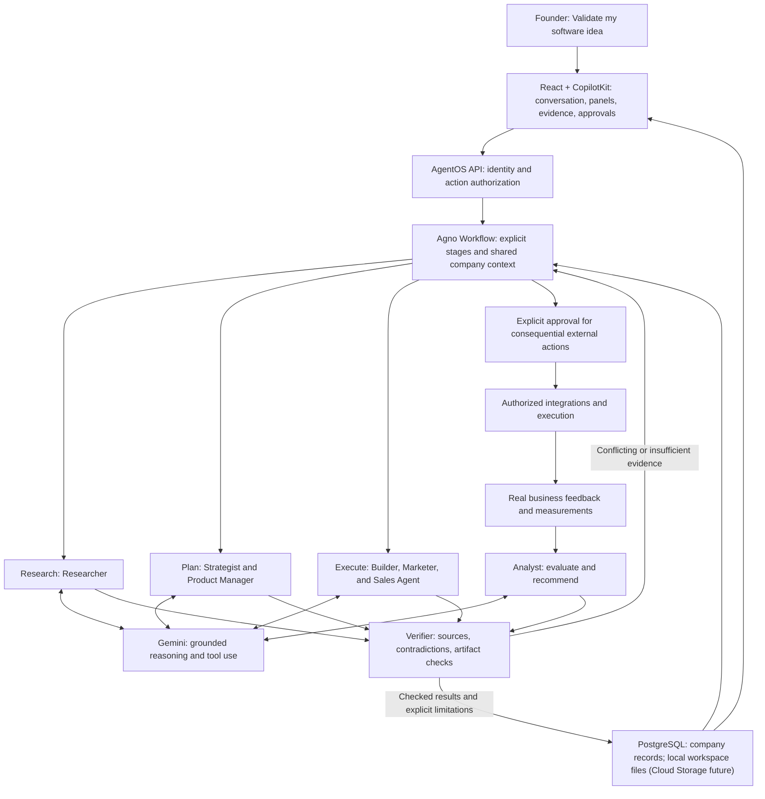

# Team Samurai — Software idea mentor

An AI mentor for validating and improving software ideas before implementation,
developed for Google AI Builder Cup 2026. Describe an app, website or software
enhancement and examine its problem, market, sales, product, resources and validation.
Iterate toward a reasoned go, revise or stop decision. Implementation follows a
reviewed decision and the founder's explicit choice through the existing workflow.

Mentor keeps pinned panels beside chat; Idea map keeps the six-aspect graph beside
that same conversation. Questions and useful structured responses use OpenUI in
chat. The first intake call can draft reasonable starting points, with unknowns and
assumptions labelled. Readiness lights and words stay inside the aspect boxes.
Readiness is a user assessment, not a success score or independent validation.
The existing backend journey and artifact lineage are reused; internal company
terminology remains in IDs and API contracts for compatibility.

Gemini's analysis, critique, evidence interpretation and revisions should drive the
validation decision. A completed map or generated draft does not justify a go.

See the [software idea mentor handoff](docs/idea-validation-handoff.md) for the six
aspects, existing backend mappings, implementation entry points, verification and
review walkthrough.

## Current status

Product direction, UI principles, and competition requirements are documented in [AGENTS.md](AGENTS.md). Samurai brand assets are available in [assets/samurai-logo](assets/samurai-logo).

The repository has the React/Vite founder UI in [frontend/](frontend/), local PostgreSQL in Podman, environment templates, and locked dependencies. The UI has onboarding, chat, generative panels, and a company dashboard. All usable ideas connect to local AgentOS through the authenticated Vite proxy. Legacy sample caches are archived without blocking the real idea directory or new idea creation. The production frontend Node server behind team-only Google IAP, including Google sign-in, live brief creation, and reload, was verified in recorded deployed revisions; that historical result does not show that the current source is deployed. See [deployment and CI/CD](docs/gcp-deployment.md). When a Gemini model is configured, the current parent-agent source registers one ordinary AgentOS agent, **Samurai**, as the conversational entry point. It has four bounded business tools: run or continue the company journey, create launch drafts, analyze provenance-labelled metrics, and read current company state. The nine specialist roles remain internal workflow executors.

## Current readiness status

The [architecture](docs/architecture.md) separates the locally verified durable queue/recovery slice from the historical cloud/IAP baseline. Original readiness Tasks 1–10 are accepted locally. The native queue implementation at `201f0f7`, formatted at `aa07b46`, the independently reviewed local PostgreSQL/Redis restore scenario, Task 7's terminal UI proof (`1a4c6a9`), and Task 10's provider-free readiness runner (`76c9884`) establish bounded local recovery. The separate Founder Platform Task 9 acceptance at `5eea8dea4c4469c39e6682879d637d5ca3dcf0f8` records 39 focused PostgreSQL file tests without skips, a full backend result of 266 passed with 105 environment-gated skips, a frontend result of 130 passed, and a provider-free Vite-BFF/IAB owner download-and-deletion flow. It does not claim an authorized GitHub Actions run. None of this deploys the current checkout. The user deferred the paid cloud queue upgrade; readiness Task 11 remains deferred and unverified while local founder work continues. The live second-account browser exercise was user-skipped, and the competition's portal-only team, deadline, and form details remain unverified.

The source defines the core journey as intake → brief check → grounded research → evidence check → strategy → product plan → verification. It retains typed, revisioned artifacts with founder statements, assumptions, source references, claims, and verification findings. Builder, Marketer, and Sales produce reviewable drafts only; Analyst requires eligible metrics and labels founder-supplied metrics as conditional. No current tool can publish, send, spend, contact prospects, run ads, or deploy.

The current Founder Platform Task 20 integration adds a typed Founder operations panel for explicit learning, bounded schedules, and deterministic low/base/high scenarios. The real local application and production-compatible BFF were exercised with provider credentials empty: learning survived a backend restart, a scheduled scenario produced exactly one receipt with zero replay receipts, company revision/state and scenario result hashes stayed unchanged across restart, and the browser rendered the typed synthetic result after reload. Task 20 exact-SHA review, broader adversarial acceptance, and full checks passed at `7b731d6`. Final integrated founder-platform manual QA remains open; see the [local acceptance snapshot](docs/local-acceptance.md) for the exact version and coverage. These scenarios are assumption checks labelled `synthetic_scenario_not_validation`; they are not observed demand or source-backed validation.

Intake, Strategist, Product Manager, and Verifier preload the validated local skill text and expose no runtime function tools. Researcher has native Gemini Search only. Builder, Marketer, Sales, and Analyst use only local read-only skill functions; the parent exposes bounded local skill inspection alongside its four business tools and two draft-presentation tools. Child workflows have a seven-model-timeout deadline (420 seconds with the default 60-second timeout), cancellation drains child runs, model requests are capped at the configured tool-call budget plus one, and child failures become sanitized typed errors.

Local onboarding validation at `d6d05fb` passed `task check`: 141 backend tests, Ruff, formatting, basedpyright, and the frontend check, type generation, and build. Separately, parent acceptance at `9002382` verified a real JWT server probe on port 8000 (unauthenticated 401, root 404, authorized configuration 200), owner-only run reads, and sanitized terminal errors. The authenticated API primary completed the five-artifact core journey to revision 5 with three unique grounded sources and nine propagated references; source-backed claims remain unverified and verification honestly returns `needs_rework`. The founder-supplied metrics path then completed at revision 6 with all seven required fields and a conditional `based_on_founder_supplied_metrics` result.

Local Chrome acceptance independently completed the approved fictional dental brief in 16 seconds, retained five unique sources, recalled the customer, budget, skills, conflicts, and next decision through `read_company_state`, and survived a reload without rerunning the child journey. A real TCP cancellation regression observed child progress, then `RunCancelled` about 20 ms after cancellation, persisted parent and child as `CANCELLED`, emptied the active registry, and retained no late artifact. These are local API, persistence, cancellation, and UI results; no live launch-draft generation, push, deployment, or external action is claimed.

The selected stack and phased implementation boundary are in [docs/architecture.md](docs/architecture.md). The active parent-agent acceptance work is in [the parent-agent plan](.omo/plans/samurai-parent-agents.md); the [AgentOS foundation plan](docs/agentos-foundation-plan.md) remains a historical record. This is not yet the complete company-building product.

## Local development

Use the task commands from the repository root. They create missing private configuration without overwriting it, start only Samurai's PostgreSQL service, and keep application servers in the foreground.

```sh
task setup          # prepare private backend configuration and locked Python dependencies
task backend:dev    # ensure setup, start PostgreSQL, then serve AgentOS on 127.0.0.1:8000
task health         # check Samurai PostgreSQL and /agentos/health without a model call
task frontend:dev   # actual founder app on 127.0.0.1:4173
```

In a second terminal, use `task db:status`, `task db:logs`, or `task db:stop`. `db:stop` preserves the Samurai volume and does not touch Reporting or other Podman services. See [the local development guide](docs/local-development.md) for prerequisites, JWT AgentOS testing, safe repeat behavior, and the technical-console/UI boundary.

The separate [Founder operations acceptance record](docs/local-development.md#founder-operations-and-restart-acceptance) covers disposable loopback PostgreSQL/Redis services and task-owned ports 8200/4200, leaving the user's app on port 4173 untouched. It exercised the actual application factory and BFF with synthetic local identities and no provider calls; its ignored harness is evidence, not a fresh-checkout setup dependency.

The local AgentOS screenshots demonstrate the saved **Samurai Local** connection, a retained journey, and state recall. They are sanitized local QA evidence, intentionally excluded from Git; the rendered output is a technical AgentOS console with raw structured JSON, not the React/Vite founder workspace.

## Explore a software idea

The founder starts with one question:

> **What do you want to build?**
>
> “An AI receptionist for Indian dental clinics.”

They interact with one mentor and an idea map. Each aspect can be discussed independently, with related assumptions and gaps visible as soft connections. Existing specialist roles remain internal executors of the unchanged research, strategy, planning and verification journey.

| Role | Produces or discovers |
|---|---|
| **Intake** | Preserves the founder's idea, customer, geography, budget, skills, goal, corrections, unknowns, and next decision. |
| **Researcher** | Competitors, pricing, target markets, reviews, and pain points, with sources and uncertainties. |
| **Strategist** | Ideal customer profile (ICP), positioning, pricing, offer, and business model grounded in the research. |
| **Product Manager** | MVP scope, user stories, delivery requirements, architecture when software is needed, and a roadmap. |
| **Builder** | Database schemas, APIs, UI, and deployment configuration for the software the business needs. |
| **Marketer** | Landing pages, Google Ads drafts, social posts, and email campaigns aligned with the offer. |
| **Sales Agent** | Qualified prospect lists, outreach drafts, sales scripts, and objection handling. |
| **Analyst** | Evaluation of measured performance and recommendations that feed back into strategy and execution. |
| **Verifier** | Checks artifact lineage, retained source support, conflicts, and unsupported numeric assumptions. |

For example, given connected analytics, the Analyst might report: “Your landing page gets traffic but conversion is only 0.8%. Here are the three changes I'd make.” This is an illustrative scenario, not an observed result or implemented capability.

The primary journey is **first pass → challenge assumptions across six aspects →
collect evidence → revise → go, revise or stop**. Small experiments and feasibility
prototypes can progress independently. After a reviewed go and the founder's explicit
choice, the existing approved workflow supports implementation and later sales and
delivery work. Generated software and campaigns do not guarantee customers or revenue.

## Logical architecture

This is the target responsibility map, implemented incrementally with React and Agno AgentOS workflows. It does not require a separate deployed service for each agent.



Gemini supports research, planning, execution, and analysis within a coordinated workflow. Deterministic code should handle permissions, validation, arithmetic, persistence, and rendering where appropriate.

The **Verifier** checks whether sources and tool results support claims, identifies contradictory information, and applies suitable checks to generated artifacts. A second model agreeing with the first is not sufficient verification. When evidence conflicts, the system should say, “I found conflicting information. I need to verify this,” and return to the relevant work with the uncertainty visible.

Generated outreach and advertising remain drafts until approved for external execution. Publishing, sending messages, spending money, and deploying require authorization for the specific action. Continuous analysis depends on connected measurements and an implemented execution mechanism.

## Repository layout

```text
team-samurai/
├── AGENTS.md             # Shared contributor instructions and product constraints
├── README.md             # Product overview and logical architecture
├── backend/
│   ├── src/samurai/      # AgentOS parent agent, internal workflows, and contracts
│   ├── pyproject.toml    # Python dependencies and checks; uv.lock pins resolution
│   └── README.md         # Backend setup and boundaries
├── frontend/
│   ├── src/              # React workspace, intake, chat, and generative panels
│   ├── package.json      # Frontend scripts; package-lock.json pins resolution
│   └── README.md         # Frontend setup and ownership
├── compose.yaml          # Local PostgreSQL through Podman
├── docs/local-development.md # Local services and Task20 acceptance harness
├── docs/architecture.md  # Selected architecture and phased build plan
└── assets/
    └── samurai-logo/     # Existing shared brand assets
```

The backend owns orchestration, execution, verification, integrations, authorization, app-owned workspace/company canonical state, and the local workspace-file lifecycle. The frontend owns the founder experience and renders server-projected structured company state; browser-local panels and drafts are not canonical state. The frontend serves the actual founder app on port 4173; preview routes and simulated transports are removed. Authenticated local intake, streamed runs, cancellation, and saved-result recovery are implemented.

## UI direction

A Hark Pro-inspired conversational workspace with an atmospheric background, frosted surfaces, floating controls, and a soft top blur. A persistent left pane shows work in progress, founder decisions, and contextual business panels. Generative UI presents interactive prospects, pricing, offers, campaigns, and performance views as they become useful.

## Intended stack

- Python 3.14, Agno AgentOS 3.1.2, and explicit workflows for backend execution.
- React 19.2.0, Vite 6.4.2, TypeScript 7.0.2, Tailwind CSS 4.3.3, assistant-ui, and Radix for the existing founder UI.
- PostgreSQL locally in Podman, with app-owned workspace/company canonical state; Cloud SQL remains the production target.
- Cloud Run application hosting has recorded historical deployment acceptance; local immutable workspace files are the default, and Cloud Storage is a future adapter/deployment option.
- Gemini for reasoning and native Google Search grounding on Researcher; the model is locked to `gemini-3.5-flash-lite`. Provider access, quota, and measured cost still require separate verification; do not commit `.env`.
- Team-only Google IAP identity is bridged server-side to per-user AgentOS JWTs; backend owner isolation remains the authorization boundary.

Framework versions were resolved on 11 October 2026. Check the manifests and lockfiles for exact versions. The backend, Cloud SQL, frontend IAP sign-in, brief execution, and automatic/manual deployment records are historical acceptance for their recorded revisions; they do not prove the current source is deployed. See AGENTS.md for the agent responsibilities, verification requirements, and submission checklist.

## Local setup

Backend requirements: Python 3.14, Task, uv, and a running Podman machine. Node.js 24 or 26 and npm are required only for the frontend UI. New contributors should use the copy/configuration commands in the directory guides rather than copying another developer's local files.

1. Install `task`, `uv`, and Podman. Install Node.js and npm only for frontend work.
2. Run `task setup`, then `task backend:dev` from the repository root.
3. In a separate terminal, run `task health`. Use `task frontend:dev` to use the founder workspace with the local authenticated proxy.

Health endpoints show process liveness, not proof of Gemini access or a completed business workflow. Keep the shared backend key server-side; this local bootstrap must not be exposed as a multi-user service.

The local AgentOS surface is `/agentos` on port 8000. JWT is the intended control-plane mode; use the actual AgentOS OpenAPI at `/agentos/docs` for the installed route schema. Historical foundation evidence and the current parent-agent verification boundary are recorded separately in [setup verification](docs/setup-verification.md). Persisted sessions alone do not establish resumable interrupted work; the local queue/recovery proof is separately bounded and has not been deployed.

## Contributing

The [16 October local acceptance snapshot](docs/local-acceptance.md) records the
founder-platform version, checks, browser/restore evidence, and remaining gates.
It is separate from historical cloud deployment evidence.

Start with [AGENTS.md](AGENTS.md), then the [backend guide](backend/README.md) or [frontend guide](frontend/README.md). Use the applicable **OMo and Ponytail skills for planning, coding, and execution**: inspect existing behavior, make the smallest complete change, and verify it through its real surface.

Before implementation, define the intended outcome and affected contracts. Coordinate changes across both directories, preserve existing product and UI decisions, and document architecture decisions where contributors can find them. Include verification evidence and clearly identify anything still planned or unverified.

Backend checks: `uv run ruff check src tests`, `uv run basedpyright`, and `uv run pytest`. Frontend checks: `npm run check` and `npm run build`. Dependency update pull requests are configured in [.github/dependabot.yml](.github/dependabot.yml); they require GitHub activation and review.

[GitHub Actions checks](.github/workflows/checks.yml) run these gates on pushes and pull requests once published. They do not require cloud credentials. The separate [deployment workflow](.github/workflows/deploy.yml) runs the same checks for its commit, then deploys backend and frontend images on pushes to `main` or manual dispatch from `main` using Google Workload Identity Federation. Recorded revisions verify IAM/WIF and key bootstrap, live frontend sign-in/brief/reload, and automatic/manual deployments; they do not prove the current source is deployed. See [the deployment guide](docs/gcp-deployment.md).

For the competition, demonstrate a focused end-to-end journey with meaningful Gemini use, visible verification, and clear user value; the full agent vision is not a claim that every role is already implemented.

## CopilotKit and generative panels

CopilotKit 1.79.0 is integrated locally through AG-UI and the existing Agno backend. The same Node frontend server hosts the open-source runtime; no CopilotKit Cloud/Enterprise account or extra agent service is used. New live companies use its headless transport while retaining Samurai's assistant-ui chat, actions, company persistence, native cancellation and saved-run recovery.

The entry form yields a declarative Company brief. Research/evidence, offer/pricing and delivery-plan panels follow the existing founder-approved stages. The OpenUI catalog also covers prospect lists and reuses the same business components in chat, Home and the dashboard. Additional views compose typed text, metrics, lists and tables. OpenUI also renders chat messages, the reply composer, company-name entry and prerequisite answer fields; assistant-ui retains runtime/draft state and CopilotKit retains authenticated AG-UI transport. Founder-requested custom HTML/CSS/JS runs in an isolated frame with embedded Inter, theme tokens, blocked host access and blocked network/navigation. Generated panels remain drafts; their definitions persist, while custom frame input values are temporary.

The integrated source was deployed on 17 October 2026. A live guest intake and reload passed; broader generative-panel validation remains provider-free. See [the generative UI contract](docs/generative-ui.md).

[Open Samurai](https://samurai-frontend-590733583260.asia-south1.run.app/) without
Google sign-in during the approved seven-day judge window. Guest sessions are
isolated and share daily usage limits. See [verification, limits and the
24 October expiry](docs/public-guest-access.md).
